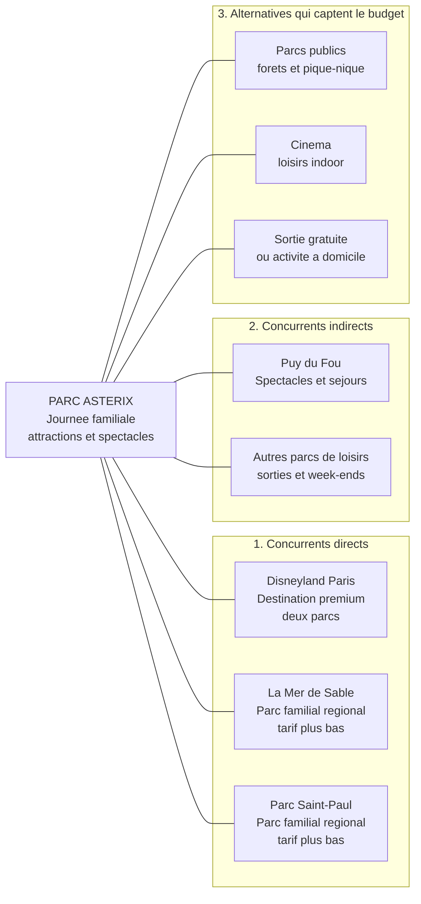
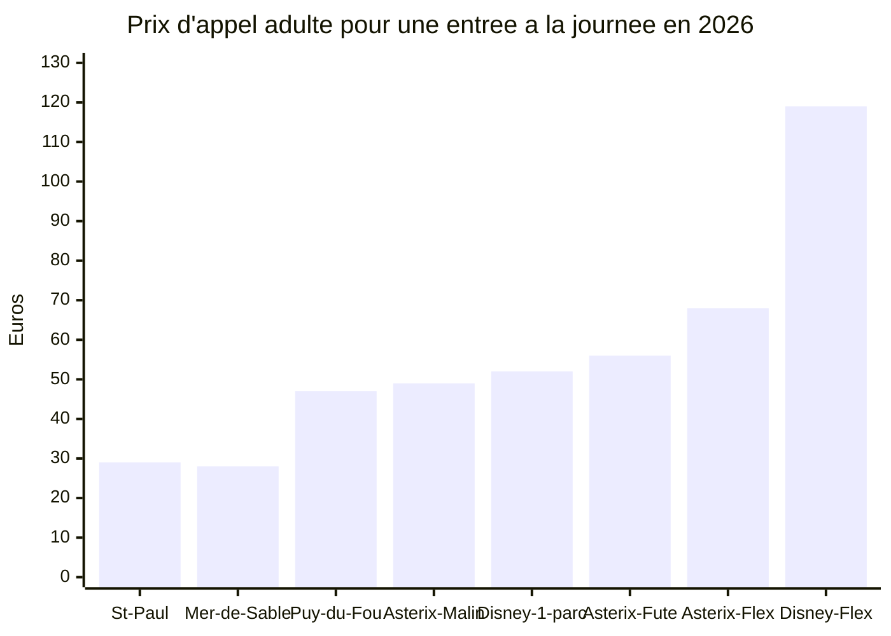
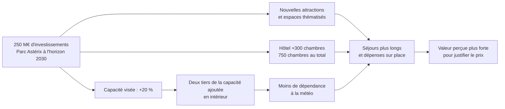

# Étude de marché — Parc Astérix

**Date de relevé : 1er octobre 2026**  
**Objet :** positionnement concurrentiel et plafond tarifaire provisoire  
**Périmètre :** sortie familiale ou entre amis, à la journée ou en court séjour, en France.

> Les tarifs d'entrée sont des prix d'appel relevés sur les sites consultés. Comme ils dépendent des dates, des quotas et des conditions d'achat, ils ne sont pas tous comparables directement. Le plafond proposé plus bas ne vaut que pour un billet adulte daté d'une journée et doit être recalculé pour la même date chez les concurrents.

## Délimitation du marché

Le Parc Astérix répond au besoin de **sortir en famille ou entre amis pour vivre une journée ou un court séjour de loisirs immersifs, à un prix jugé acceptable, principalement en Île-de-France et dans le nord de la France**.

Le parc a annoncé **2,9 millions de visiteurs sur la saison 2024-2025**. Le classement TEA donne **2,842 millions de visites en 2024** au Parc Astérix, contre **10,214 millions** au Parc Disneyland et **5,598 millions** au second parc Disney. Le classement compte des visites par parc, et non des visiteurs uniques du complexe Disney; il porte sur l'année civile 2024, tandis que le chiffre Astérix 2,9 M concerne une saison.

Sources : [chiffres clés Parc Astérix](https://newsroom.parcasterix.fr/entreprise/chiffres-cles/) · [classement TEA 2024](https://interpark.co.uk/latest-news/tea-2024-index-releases-visitor-attendance-report/)

## Les trois cercles de concurrence

Disneyland Paris est le comparable premium pour une journée dans un parc à thème. La Mer de Sable et le Parc Saint-Paul exercent une pression surtout sur le budget des familles de la région; leur taille et leur offre sont différentes. Le Puy du Fou répond davantage à une demande de spectacles et de séjours.

## Comparaison des tarifs

Prix d'entrée adulte affichés ou prix d'appel au 1er octobre 2026. La présence de deux parcs, la date choisie, la flexibilité et les services inclus changent la valeur de l'offre.

| Acteur | Offre observée | Prix adulte | Conditions et comparabilité |
|---|---|---:|---|
| Parc Astérix | Billet Malin | 49 € | Tarif unique, quantité limitée, billet daté |
| Parc Astérix | Billet Futé | à partir de 56 € | Billet daté, réservation au plus tard à J-7 |
| Parc Astérix | Liberté Flex | 68 € | Billet adulte modifiable, réservation possible jusqu'au jour J |
| Disneyland Paris | Billet daté, 1 jour / 1 parc | 52 à 59 € en période verte | Prix variable selon la date et la demande |
| Disneyland Paris | Billet daté, 1 jour / 2 parcs | 87 à 94 € en période verte | Deux parcs; offre différente d'une journée Astérix |
| Disneyland Paris | Billet Liberté, 1 jour / 1 parc | 119 € | Date flexible |
| La Mer de Sable | Billet daté Citrouille | à partir de 28 € | Achat web, places disponibles limitées; guichet : 34,90 € |
| Parc Saint-Paul | Billet non daté | à partir de 29 € | Parking gratuit; plus de 35 attractions annoncées |
| Puy du Fou | Billet journée | à partir de 47 € | Offre centrée sur les spectacles; tarifs variables selon la date |

Le billet Malin d'Astérix n'est pas une référence de prix garantie pour toutes les dates. Inversement, le minimum Disney est un tarif de période verte. Pour une comparaison économique rigoureuse, il faut relever les calendriers le même jour, pour la même date de visite, les mêmes âges et la même flexibilité.

Sources : [billetterie Astérix](https://www.parcasterix.fr/offres/billets) · [billetterie Disney](https://tickets.disneylandparis.com/fr-fr/tickets) et [grille 2026 indépendante](https://disneyland-pratique.fr/tarifs-disneyland-paris-2026.html) · [tarifs Mer de Sable](https://www.merdesable.fr/tarifs-reservations) · [site Parc Saint-Paul](https://www.parcsaintpaul.fr/) · [tarifs Puy du Fou](https://www.puydufou.com/france/fr/billets-puy-du-fou-france)

Le graphique donne des points d'entrée et non des paniers comparables à date égale. Il visualise l'écart de flexibilité, mais ne signifie pas que l'ensemble de l'offre Disney soit équivalente au billet Astérix.

## Santé financière et capacité d'investissement

| Acteur | Données publiques repérées | Lecture et limites |
|---|---|---|
| Parc Astérix / Compagnie des Alpes | CDA 2024-2025 : chiffre d'affaires de **1 397 M€**, EBO de **409 M€**, résultat net part du groupe de **107 M€**. Division Parcs de loisirs : EBO de **176 M€**, marge d'EBO de **26 %**. | Le parc ne publie pas de comptes autonomes dans les sources consultées. Les résultats CDA sont des données consolidées de groupe et de division, pas les résultats propres d'Astérix. |
| Disneyland Paris / Euro Disney Associés SAS | Exercice 2024-2025 : chiffre d'affaires de **2,68 Md€**, résultat d'exploitation de **271 M€**, résultat net de **260 M€**. | Les comptes couvrent l'exploitant de la destination. L'Écho touristique relève que le résultat net bénéficie aussi de pertes fiscales antérieures reportées. |
| La Mer de Sable / Looping | Mer de Sable : chiffre d'affaires annuel annoncé à un peu plus de **12 M€**; **400 000 visiteurs en 2025**. Looping annonçait plus de **250 M€ de chiffre d'affaires** et 21 sites européens en 2025. | Le chiffre du parc est publié dans la presse; il ne s'agit pas d'un compte consolidé audité fourni ici. Les données de Looping sont celles du groupe, pas celles du seul parc. |
| Parc Saint-Paul | Chiffre d'affaires rapporté : **9,85 M€ en 2024** et **7,49 M€ en 2025**. | Baisse à surveiller; les données consultées ne suffisent pas à en établir la cause ni à conclure sur la rentabilité. |
| Puy du Fou France | 2024 : chiffre d'affaires de **184,2 M€**, EBE de **48,2 M€**, résultat net de **26,1 M€**. | Comptes publiés de la société Puy du Fou France; la destination et les activités de groupe ne se résument pas toutes à un seul billet de parc. |

Sources : [résultats CDA 2024-2025](https://news.compagniedesalpes.com/resultats-2024-2025-perspectives/) · [résultats Disney rapportés par L'Écho touristique](https://www.lechotouristique.com/article/en-2025-disneyland-paris-a-triple-son-resultat-net) · [situation Mer de Sable en 2026](https://www.lejournaldesentreprises.com/breve/la-mer-de-sable-conserve-son-niveau-de-frequentation-apres-un-printemps-complique-2145363) · [acquisition de Saint-Paul par Looping](https://www.lejournaldesentreprises.com/breve/le-breton-looping-acquiert-le-parc-saint-paul-dans-loise-2117693) · [investissements Saint-Paul 2026](https://www.lejournaldesentreprises.com/breve/le-parc-saint-paul-investit-5-millions-deuros-pour-accelerer-sa-relance-2146434) · [comptes Puy du Fou France](https://www.pappers.fr/entreprise/puy-du-fou-france-347490070)

## Investissements et stratégies

| Acteur | Investissement / nouveauté | Logique stratégique |
|---|---|---|
| Parc Astérix | **250 M€ à l'horizon 2030**; hôtel de 300 chambres; capacité visée en hausse de 20 %, dont deux tiers en intérieur. | Renouveler l'offre, augmenter la capacité, réduire la dépendance à la météo et accroître les séjours et les dépenses sur place. |
| Disneyland Paris | **2 Md€** annoncés pour transformer le second parc; Disney Adventure World et World of Frozen ouverts le 29 mars 2026. | Renforcer les licences propriétaires et l'attractivité internationale, notamment pour des séjours de plusieurs jours. |
| La Mer de Sable | **5,5 M€** investis dans le coaster Wild Buffalo, ouvert en 2025; la direction évoque 20 000 visiteurs supplémentaires visés. | Rajeunir l'offre régionale avec une nouveauté à sensations mais accessible aux familles. |
| Parc Saint-Paul | **5 M€** annoncés pour 2026, dont 3 M€ pour la tour SkyFall de 60 mètres. | Moderniser le parc et développer les sensations fortes tout en gardant son positionnement familial et ses prix bas. |
| Puy du Fou | **70 M€** de programme annoncé en 2026, dont 50 M€ en France; 100 chambres supplémentaires et saison portée à 196 jours. | Étendre les séjours et la saison, augmenter la valeur dépensée par visiteur et renforcer la montée en gamme. |

Source Astérix : [plan officiel de développement](https://newsroom.parcasterix.fr/entreprise/projets-et-developpement/). Source Disney : [communiqué officiel sur l'ouverture](https://news.disneylandparis.com/en/disneyland-paris-enters-a-new-era-with-the-inauguration-of-world-of-frozen-and-the-many-new-experiences-at-disney-adventure-world-its-reimagined-second-park/). Source Mer de Sable : [Le Journal des Entreprises](https://www.lejournaldesentreprises.com/article/la-mer-de-sable-investit-55-millions-deuros-dans-une-nouvelle-attraction-2115029). Source Puy du Fou : [Le Journal des Entreprises](https://www.lejournaldesentreprises.com/article/le-puy-du-fou-investit-70-millions-deuros-pour-soutenir-sa-croissance-2140517).

## Prix plafond provisoire

Le prix plafond ne peut pas être unique pour toutes les dates. Pour un adulte, un billet daté **1 jour / 1 parc, en période verte**, le repère Disney publié est de **52 à 59 €**. **59 € constitue donc un plafond de comparaison provisoire pour cette catégorie et cette période**, pas un maximum de marché valable toute l'année. Il faut le vérifier à date égale dans la billetterie officielle Disney, car ses tarifs varient avec la date et la demande.

Le Billet Futé Astérix à partir de **56 €** est déjà proche de ce plafond. Une hausse générale du tarif daté risquerait d'effacer l'avantage prix sur les périodes calmes. Le billet flexible à **68 €**, en revanche, reste nettement sous le billet flexible Disney à **119 €**. Les plus petits concurrents régionaux, à environ **28–29 €**, contraignent aussi l'image d'accessibilité, sans être une offre équivalente en taille ni en contenu.

**Conclusion :** le Parc Astérix peut relever certains prix, mais plutôt sur les dates de forte demande et les options de flexibilité. Il devrait protéger un tarif d'appel visible et financer sa montée en gamme aussi par l'hôtellerie, la restauration et la hausse de fréquentation, plutôt que par le seul billet d'entrée.

## Première idée en trois lignes

**Offre :** un Billet Gaulois Malin, daté, réservé à l'avance et disponible sur des jours de semaine ou de faible affluence.  
**Public :** familles sensibles au prix qui peuvent adapter leur date et cherchent une journée complète d'attractions et de spectacles.  
**Prix d'essai :** **49 € par personne** sur une sélection limitée de dates; garder le billet standard à partir de **56 €** et le Flex à **68 €**, puis vérifier la réaction des clients avant d'élargir l'offre.

## Méthode et limites

- Tarifs relevés le **1er octobre 2026** sur les pages citées. Les offres à partir de dépendent des disponibilités et peuvent évoluer.
- Pour la version finale du dossier, conserver une capture d'écran datée de chaque tarif et relever Disney pour exactement la même date.
- Les fréquentations citées couvrent des périodes différentes : année civile 2024, saison 2024-2025 ou année 2025 selon la source.
- Quand les comptes propres au parc ne sont pas accessibles, les résultats du groupe ou de sa division sont indiqués comme tels, sans les attribuer à l'établissement.
- Les alternatives gratuites n'ont pas de comptes financiers comparables; elles sont mentionnées comme concurrence pour le temps libre et le budget, sans chiffres inventés.
